

<picture>
  <source media="(prefers-color-scheme: dark)" srcset="./assets/header-dark.svg" />
  
</picture>

 

  

**`Super Junior Programmer :)`** — I build the whole stack myself, from the DNS resolver up to the page you land on.

 

<picture>
  <source media="(prefers-color-scheme: dark)" srcset="./assets/sakura/dark/section-about.svg" />
  
</picture>

I'm **Hanahira** (花平, *はなひら* — "a blooming flower"), and **HanahiraNetwork** is my corner of the internet.

Most of what I make is the same shape: **small, fast services that run on my own hardware** — Bun or Go,
packed into **Docker**, sitting behind a reverse proxy I wrote myself. Lately that also means tooling around
**Claude Code** and **VRChat**, and I still keep a soft spot for **ComfyUI** extensions and **C++ on microcontrollers**.

<picture>
  <source media="(prefers-color-scheme: dark)" srcset="./assets/sakura/dark/about.svg" />
  
</picture>

  

<picture>
  <source media="(prefers-color-scheme: dark)" srcset="./assets/sakura/dark/section-network.svg" />
  
</picture>

 

<a href="https://dns.hanahira.dev/"><picture>
  <source media="(prefers-color-scheme: dark)" srcset="./assets/sakura/dark/service-dns.svg" />
  
</picture></a>
<a href="https://vpn.hanahira.dev/"><picture>
  <source media="(prefers-color-scheme: dark)" srcset="./assets/sakura/dark/service-vpn.svg" />
  
</picture></a>
 
<a href="https://cloud.hanahira.dev/"><picture>
  <source media="(prefers-color-scheme: dark)" srcset="./assets/sakura/dark/service-cloud.svg" />
  
</picture></a>
<a href="https://status.hanahira.dev/"><picture>
  <source media="(prefers-color-scheme: dark)" srcset="./assets/sakura/dark/service-status.svg" />
  
</picture></a>
 
<a href="https://hanahira.dev/"><picture>
  <source media="(prefers-color-scheme: dark)" srcset="./assets/sakura/dark/service-security.svg" />
  
</picture></a>
<a href="https://hanahira.dev/"><picture>
  <source media="(prefers-color-scheme: dark)" srcset="./assets/sakura/dark/service-tools.svg" />
  
</picture></a>

🌸 Tools: <a href="https://speed.hanahira.dev/">Speed test</a> · <a href="https://hanahira.dev/JLPT">JLPT practice</a> · <a href="https://hanahira.dev/qr">QR generator</a> · <a href="https://hanahira.dev/portfolio/">Portfolio</a> — everything is self-hosted and built from scratch; source is private, the services are live.

 

<picture>
  <source media="(prefers-color-scheme: dark)" srcset="./assets/sakura/dark/section-projects.svg" />
  
</picture>

 

<a href="https://github.com/KBYSHanahira/ClaudeHanahiraUI"><picture>
  <source media="(prefers-color-scheme: dark)" srcset="./assets/sakura/dark/project-ClaudeHanahiraUI.svg" />
  
</picture></a>
<a href="https://github.com/KBYSHanahira/HanahiraVRCTools"><picture>
  <source media="(prefers-color-scheme: dark)" srcset="./assets/sakura/dark/project-HanahiraVRCTools.svg" />
  
</picture></a>
 
<a href="https://github.com/KBYSHanahira/kikitan-translator"><picture>
  <source media="(prefers-color-scheme: dark)" srcset="./assets/sakura/dark/project-kikitan-translator.svg" />
  
</picture></a>
<a href="https://github.com/KBYSHanahira/Civicomfy"><picture>
  <source media="(prefers-color-scheme: dark)" srcset="./assets/sakura/dark/project-Civicomfy.svg" />
  
</picture></a>
 
<a href="https://github.com/KBYSHanahira/sd-civitai-browser-plus"><picture>
  <source media="(prefers-color-scheme: dark)" srcset="./assets/sakura/dark/project-sd-civitai-browser-plus.svg" />
  
</picture></a>
<a href="https://github.com/KBYSHanahira?tab=repositories"><picture>
  <source media="(prefers-color-scheme: dark)" srcset="./assets/sakura/dark/project-older.svg" />
  
</picture></a>

  

<picture>
  <source media="(prefers-color-scheme: dark)" srcset="./assets/sakura/dark/section-stack.svg" />
  
</picture>

 

<picture>
  <source media="(prefers-color-scheme: dark)" srcset="./assets/sakura/dark/stack.svg" />
  
</picture>

  

<picture>
  <source media="(prefers-color-scheme: dark)" srcset="./assets/sakura/dark/section-numbers.svg" />
  
</picture>

 

<picture>
  <source media="(prefers-color-scheme: dark)" srcset="./assets/sakura/dark/stats-overview.svg" />
  
</picture>

 

<picture>
  <source media="(prefers-color-scheme: dark)" srcset="./assets/sakura/dark/stats-languages.svg" />
  
</picture>
<picture>
  <source media="(prefers-color-scheme: dark)" srcset="./assets/sakura/dark/stats-hours.svg" />
  
</picture>

  

<picture>
  <source media="(prefers-color-scheme: dark)" srcset="./assets/sakura/dark/section-graph.svg" />
  
</picture>

 

<picture>
  <source media="(prefers-color-scheme: dark)" srcset="https://raw.githubusercontent.com/KBYSHanahira/KBYSHanahira/output/github-contribution-grid-snake-dark.svg" />
  
</picture>

  

<picture>
  <source media="(prefers-color-scheme: dark)" srcset="./assets/footer-dark.svg" />
  
</picture>

