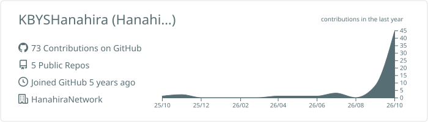
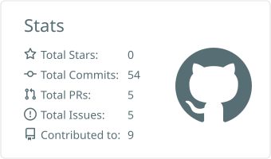
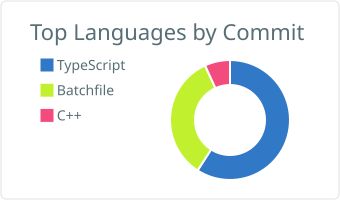
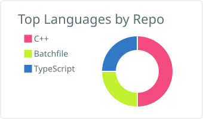
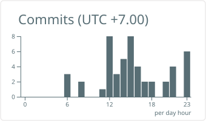

<div align="center">

<picture>
  <source media="(prefers-color-scheme: dark)" srcset="./assets/header-dark.svg" />
  
</picture>

<br />

<a href="https://hanahira.dev/"></a>
<a href="https://x.com/HanahiraDev"></a>
<a href="https://discord.hanahira.dev/"></a>
<a href="https://github.com/KBYSHanahira?tab=repositories"></a>


<br /><br />

**`Super Junior Programmer :)`** — I build the whole stack myself, from the DNS resolver up to the page you land on.

</div>

<br />

## 🌸 私について · About me

I'm **Hanahira** (花平, *はなひら* — "a blooming flower"), and **HanahiraNetwork** is my corner of the internet.

Most of what I make is the same shape: **small, fast services that run on my own hardware** — Bun or Go,
packed into **Docker**, sitting behind a reverse proxy I wrote myself. Lately that also means tooling around
**Claude Code** and **VRChat**, and I still keep a soft spot for **ComfyUI** extensions and **C++ on microcontrollers**.

```ts
const hanahira = {
  handle:   "KBYSHanahira",
  network:  "https://hanahira.dev",
  builds:   ["DNS", "VPN", "cloud storage", "status pages", "a reverse proxy / WAF"],
  stack:    ["Bun", "Hono", "Go", "TypeScript", "Preact", "MySQL", "PostgreSQL", "Docker"],
  sideQuests: ["Claude Code mods", "VRChat tools", "ComfyUI", "Arduino"],
  motto:    "Ship it small, ship it self-hosted. 🌸",
} as const;
```

<br />

## 🌐 ネットワーク · HanahiraNetwork

<sub>Everything below is self-hosted on my own machines and built from scratch. Source is private — the services are live.</sub>

| | Service | What it does | Built with |
| :---: | --- | --- | --- |
| 🧭 | **[DNS](https://dns.hanahira.dev/)** | Recursive / forwarding resolver over UDP, TCP, DoT and DoH — filtering, rewrites, monitoring, leader + hot-standby HA | `Bun` `React` `PostgreSQL` |
| 🔐 | **[VPN](https://vpn.hanahira.dev/)** | WireGuard access management — approval sign-up, self-service devices with QR codes, traffic history, TOTP 2FA, 25 languages | `Bun` `Hono` `Vite` |
| ☁️ | **[Cloud](https://cloud.hanahira.dev/)** | Private cloud storage — nested folders, password / expiring share links, video & audio streaming, quotas, audit log | `Bun` `Hono` `Preact` `MySQL` |
| 📈 | **[Status](https://status.hanahira.dev/)** | Public status page and ops panel for servers, Docker and databases in one | `Bun` `Hono` `Preact` |
| 🛡️ | **Web Security** | The gateway in front of it all — single Go binary: routing, TLS/ACME, HTTP/3, WAF, rate limits, OIDC login | `Go` |
| 🧰 | **[Tools](https://hanahira.dev/)** | [Speed test](https://speed.hanahira.dev/) · [JLPT practice](https://hanahira.dev/JLPT) · [QR generator](https://hanahira.dev/qr) · [Portfolio](https://hanahira.dev/portfolio/) | `Hono` `Vite` |

<br />

## 📦 作品 · Open source

| Project | What it is | |
| --- | --- | --- |
| 🌸 **[ClaudeHanahiraUI](https://github.com/KBYSHanahira/ClaudeHanahiraUI)** | Interface mod for Claude Code — a status band above the prompt with ring gauges for context and 5h / 7d limits, cost / token / time cards, live agent cards and styled conversation logs |  |
| 🩹 **[HanahiraVRCTools](https://github.com/KBYSHanahira/HanahiraVRCTools)** | One-click Windows repair kit for VRChat — crashes, EAC, cache, IME, Discord hook, network and audio. One `.bat`, nothing to install |  |
| 🗣️ **[kikitan-translator](https://github.com/KBYSHanahira/kikitan-translator)** | Real-time speech translation for VRChat — voice to chatbox over OSC, desktop-audio subtitles and a VR overlay. <sub>fork of YusufOzmen01/kikitan-translator</sub> |  |
| ⬇️ **[Civicomfy](https://github.com/KBYSHanahira/Civicomfy)** | Civitai model downloader for ComfyUI. <sub>fork of MoonGoblinDev/Civicomfy</sub> |  |
| 🔎 **[sd-civitai-browser-plus](https://github.com/KBYSHanahira/sd-civitai-browser-plus)** | Browse, download and update Civitai models from inside the SD WebUI. <sub>fork of BlafKing/sd-civitai-browser-plus</sub> |  |

<sub>Older, from the learning days: [Data-Structure](https://github.com/KBYSHanahira/Data-Structure) (C++) · [Arduino](https://github.com/KBYSHanahira/Arduino) (C++)</sub>

<br />

## 🌿 技術スタック · Tech stack

<div align="center">


<br />


<br />


<br />


</div>

<br />

## 📊 統計 · GitHub in numbers

<div align="center">

<picture>
  <source media="(prefers-color-scheme: dark)" srcset="./profile-summary-card-output/github_dark/0-profile-details.svg" />
  
</picture>

<picture>
  <source media="(prefers-color-scheme: dark)" srcset="./profile-summary-card-output/github_dark/3-stats.svg" />
  
</picture>
<picture>
  <source media="(prefers-color-scheme: dark)" srcset="./profile-summary-card-output/github_dark/2-most-commit-language.svg" />
  
</picture>

<picture>
  <source media="(prefers-color-scheme: dark)" srcset="./profile-summary-card-output/github_dark/1-repos-per-language.svg" />
  
</picture>
<picture>
  <source media="(prefers-color-scheme: dark)" srcset="./profile-summary-card-output/github_dark/4-productive-time.svg" />
  
</picture>

</div>

<br />

## 🐍 貢献グラフ · Contribution graph

<div align="center">

<picture>
  <source media="(prefers-color-scheme: dark)" srcset="https://raw.githubusercontent.com/KBYSHanahira/KBYSHanahira/output/github-contribution-grid-snake-dark.svg" />
  
</picture>

<sub>🌸 the petals fall as the snake passes</sub>

<br /><br />

<picture>
  <source media="(prefers-color-scheme: dark)" srcset="./assets/footer-dark.svg" />
  
</picture>

</div>
